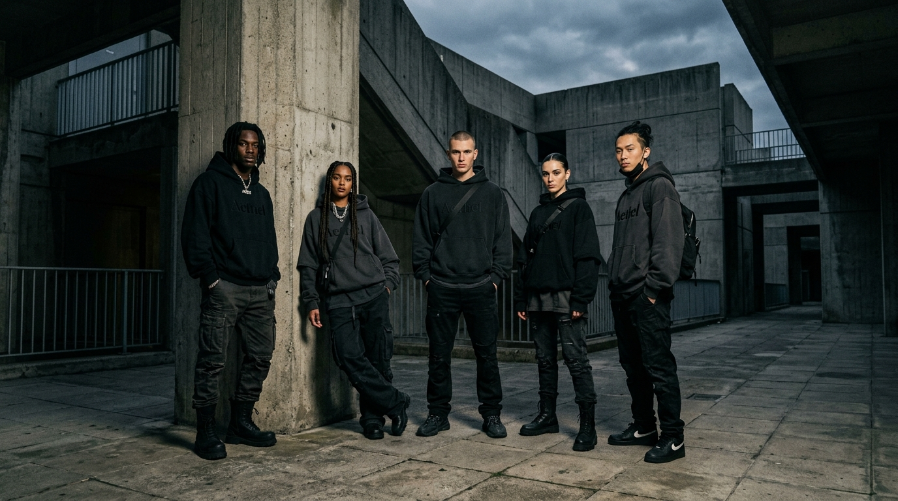

# NEVERMIND // Haute Streetwear E-Commerce Platform

A dark-themed, responsive e-commerce web application inspired by avant-garde luxury streetwear layouts (such as Fear of God, Balenciaga, Represent, and Mastermind).



---

## ⚡ Features & Architecture

### 1. Minimalist Announcement Bar & Navigation Header
- **Announcement Banner**: Floating black banner featuring clean white uppercase typography: `"LIMITED RELEASES. EXCLUSIVE DROPS. ELEGANCE IS NOW LIVE"`, with a live pulse indicator, dismiss button, and interactive multi-currency switcher.
- **Sticky Header**: Frosted glassmorphism backdrop blur (`rgba(12, 12, 12, 0.88)` + `backdrop-filter: blur(20px)`), left-aligned links (`Home`, `Catalog`, `About`, `Contact`), bold center-aligned brand logo (`NEVERMIND`), and right-aligned icons for live search, VIP account, wishlist, and cart drawer.
- **Mobile Navigation Drawer**: Slide-in mobile menu.

### 2. High-Fashion Editorial Hero Section
- Full-width editorial background featuring models in matching dark streetwear hoodies.
- Centered bold typography: **`STYLE VIBE REFLECT`**.
- Secondary manifesto body copy and centered white **`SHOP NOW`** button with hover inversion.
- Bottom metadata statistics bar (`150 PCS / SILHOUETTE`, animated scroll indicator).

### 3. Brand Statement Banner
- Section title: **`DESIGNED TO DISRUPT`** with watermark graphics.
- Copy emphasizing precision-tailored disruptor pieces, custom 480–500 GSM loopback French Terry, and bespoke hardware.

### 4. 4-Column Product Catalog
- Curated collection of unisex streetwear hoodies highlighting back-prints:
  - **Los Angeles Reconstruction Hoodie** (LA cartography & coordinates)
  - **Ecstasy Smile Acid Wash Hoodie** (Subversive melting acid-wash smile)
  - **Cybernetic Specimen Technical Hoodie** (Cyber spine schematic: "DESIGNED TO DISRUPT")
  - **Nevermind Monolith Heavyweight Hoodie** (Monolithic puff-print arch logo)
  - **Vanitas Sculptural Marble Hoodie** (Classical marble sculpture with silver thorns)
  - **Disrupt V2 Blueprint Hoodie**, **Downtown Cartography Coordinates Hoodie**, and **Acid Wash Distortion Hoodie**
- Sale tags, original struck-through prices, discounted **Philippine Peso (PHP ₱)** pricing, and interactive size pills (`S`, `M`, `L`, `XL`).
- Interactive hover states: Alternate angle/macro image reveals, Quick View modal, Wishlist bookmark toggle, and Add to Bag.
- Filter tabs (`All Pieces`, `Graphic Back-Prints`, `Acid Wash`, `Heavyweight 500GSM`) and live sorting dropdown.

### 5. Marquee Ticker
- Continuous, smooth CSS marquee ticker repeating alternating tags:
  `[LIMITED EDITION] ✦ [NEW ARRIVAL]`.

### 6. Campaign Lookbook Gallery
- Integrated editorial showcase featuring Drop 004 fits photographed on 35mm film aesthetic with instant Quick View triggers.

### 7. Story / Split Sections (Mission & Vision)
- **Our Mission**: Two-column layout pairing editorial model photography with the manifesto copy and an interactive `"Learn More"` button opening the Atelier Dossier.
- **Our Vision**: Alternating reverse layout pairing editorial model photography with cultural permanence copy and an interactive `"Learn More"` button.

### 8. Interactive Drawers & Modals
- **Slide-Out Cart Drawer**: Line item management, quantity adjusters, free express shipping progress bar, promo code system (`DISRUPT10`, `ELEGANCE`, `VIPDROP`, `FREESHIP`), and checkout button.
- **Wishlist Drawer**: Saved items stored in `localStorage` with one-click "Move to Bag".
- **Quick View Modal**: Dual-angle thumbnail switcher (back-print vs macro detail), fabric specifications, live inventory counter, and link to the oversized fit size matrix.
- **Size Guide Modal**: Complete measurement matrix for oversized streetwear drape (Chest, Length, Shoulder, Sleeve in CM).
- **Search Modal**: Instant real-time search across all hoodies, graphics, and GSM weights.
- **Checkout Simulation Modal**: Philippine shipping details, local payment methods (GCash, Maya, Cards, COD), and order confirmation.

---

## 🎨 Design System Specifications

- **Color Scheme**: Absolute dark theme (`#0c0c0c` primary background, crisp `#ffffff` typography, and `#1f1f1f` / `#2e2e2e` muted grey borders).
- **Typography**: Modern bold sans-serif fonts with generous tracking (`Syne`, `Space Grotesk`, `Inter`).
- **Responsive Breakpoints**: Optimized for mobile phones (375px+), tablets (768px+), laptops (1024px+), and ultrawide desktop viewports.

---

## 🚀 Running Locally

No Node.js or external build tools required. Built with modern HTML5, Vanilla CSS3, and ES6+ JavaScript.

1. Clone the repository:
   ```bash
   git clone https://github.com/nehaqayyum567/Shopify_Website.git
   cd Shopify_Website
   ```

2. Start a local server:
   ```bash
   # Using Python:
   python -m http.server 8000
   ```

3. Open your browser:
   Visit `http://localhost:8000/`.

---

## 📁 Repository Structure

```
.
├── index.html              # Main HTML5 document
├── README.md               # Project documentation
├── css/
│   ├── style.css           # Core design tokens, typography, and reset
│   └── components.css      # Component styles (header, hero, cards, drawers, modals)
├── js/
│   ├── products.js         # Products database, multi-currency conversion & sizing specs
│   ├── cart.js             # Cart state, wishlist, promo codes & checkout
│   └── app.js              # Catalog filtering, search, modals & interactions
└── assets/
    └── images/             # High-fashion editorial photography & product assets
```

---

## 📄 License

MIT License. Designed & developed for NEVERMIND Archive.
